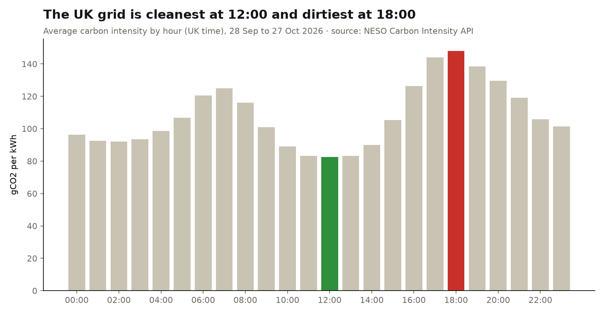
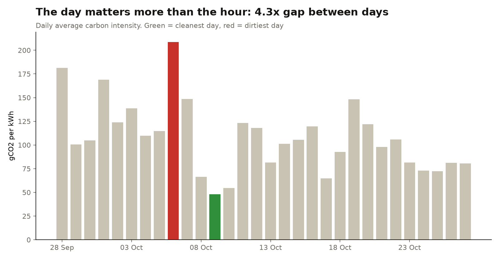
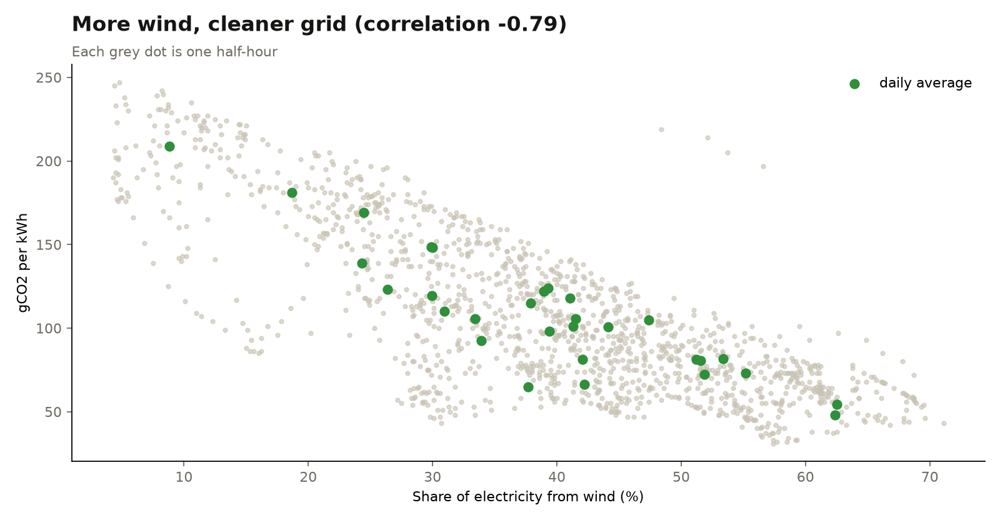

# When is the UK grid greenest? ⚡🌱

A beginner-friendly data project with **free public data, no API key, about an hour, Python only**.

**The question:** if you want to use electricity when it's cleanest (charging an EV, running the washing machine), *when* should you do it?

**The answer, from 30 days of real data (28 Sep to 27 Oct 2026):**

| Finding | Number |
|---|---|
| Cleanest hour of the day (UK time) | **12:00**, 82 gCO₂/kWh on average (solar) |
| Dirtiest hour | **18:00**, 148 gCO₂/kWh (evening peak, more gas) |
| Gap between the best and worst hour | **1.8×** |
| Gap between the cleanest and dirtiest **day** | **4.3×** (9 Oct: 48, 6 Oct: 209) |
| What drives it | **Wind**. Correlation with wind share: **−0.79** |
| Weekends vs weekdays | 91 vs 114, so weekends are about 20% cleaner |

**So what:** picking the right hour helps, but **picking the right day helps more**. A windy day is cleaner than the best hour of a calm one, so check the forecast before you charge.





---

## Run it yourself (step by step)

You need Python 3.10+ installed. Then, in a terminal:

```bash
git clone https://github.com/anastheanalyst-dev/uk-grid-greenest-hour.git
cd uk-grid-greenest-hour
pip install -r requirements.txt
python 01_get_data.py      # downloads 30 days of data into data/
python 02_analyse.py       # prints the findings and saves the charts into charts/
```

### What each step does

**`01_get_data.py`: get the data**
- It calls the free [Carbon Intensity API](https://carbonintensity.org.uk) run by NESO, Great Britain's electricity system operator.
- Two endpoints are used: `/intensity` gives grams of CO₂ per kWh every 30 minutes, and `/generation` gives the % that came from wind, gas, solar, nuclear and so on.
- The API allows a maximum of 14 days per request, so the script loops one week at a time.
- It saves everything as two CSV files.

**`02_analyse.py`: answer the question**
1. **Fix the time.** The API speaks UTC, but people live in UK time, and the clocks went back on 25 Oct. `tz_convert("Europe/London")` handles that properly. (Adding "+1 hour" would be wrong for half the month.)
2. **Average by hour** with `groupby("hour")`, then find the min and the max.
3. **Average by day**, then compare the cleanest and dirtiest days.
4. **Look for a driver.** A correlation between carbon intensity and wind share shows how strongly they move together.
5. **Draw charts that answer the question.** Grey bars, ONE highlight colour, and a title that *is* the finding.

---

## Make it yours (so it's not the same project as everyone else's)

- **Go regional.** `/regional` gives 14 GB regions. Is Scotland cleaner than London?
- **Check the forecast.** How accurate is the API's own forecast compared with what actually happened?
- **Build a "best time to charge" tool.** Use the 48-hour forecast endpoint to find tomorrow's cleanest 3 hours.
- **Make a dashboard.** Load the CSVs into Power BI or Tableau Public.
- **Compare seasons.** Change `END` and `DAYS` in step 1 to look at summer vs winter.

## Add it to your portfolio

Put the repo link and one chart on your portfolio site. Some free options:
- [datascienceportfol.io](https://www.datascienceportfol.io)
- GitHub Pages
- Tableau Public

Write it up like the table at the top: **question → answer → so what**.

---

**Data:** NESO Carbon Intensity API (carbonintensity.org.uk), licensed CC BY 4.0. **Code:** MIT.
A personal learning project using public data, made for [@anas.theanalyst](https://instagram.com/anas.theanalyst).
